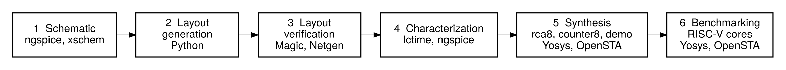

# Sub-Threshold Standard Cell Library for SkyWater sky130A

     

A 13-cell digital standard cell library for sub-threshold operation at 0.40 V on the SkyWater sky130A 130 nm process. Every step, from transistor sizing to RISC-V benchmarks, runs with open-source tools inside the [iic-osic-tools](https://github.com/iic-jku/iic-osic-tools) Docker image, one command per stage.

## Highlights

- 13 cells: inverter, NAND2, NOR2, AND2, OR2, XOR2, XNOR2, AOI21, OAI21, two 4-input AOI/OAI variants, D latch and D flip-flop.
- Sized for a fanout-of-4 load with a noise margin of at least 40 mV at every critical corner, checked with Monte Carlo mismatch.
- Generated layouts on a 4.08 µm template: 0 DRC errors and LVS match for every cell.
- Liberty files and HTML datasheets at 15 PVT corners, characterized on extracted R+C netlists.
- 6.0× to 11.3× lower energy per instruction than sky130_fd_sc_hd at 1.80 V on four open-source RISC-V cores.

## Flow



Each stage is documented in `docs/` (start at `docs/index.md`).

## Results

### 1. Schematic

| Sizing criterion | Target | Result |
|---|---|---|
| Noise margin, critical corners (tt 27, sf 0, fs 85, ss 85, ff 85 °C) | ≥ 40 mV | met by all 13 cells |
| Rise / fall asymmetry at tt 27 °C | ≤ 25 % | met by all 11 combinational cells |
| Monte Carlo mismatch, mean − 3σ of the noise margin | ≥ 0 | met by all 13 cells |
| Output swing | 0 to VDD | met by all 13 cells |

Cells use 2 (INV1X4) to 18 (DFFX4) transistors. Sizes per cell: `docs/01_schematic.md`.

### 2. Layout generation

| Property | Value |
|---|---|
| Cell height | 4.08 µm |
| Site width | 0.46 µm |
| Narrowest cell | INV1X4, 2.30 µm (9.38 µm²) |
| Widest cell | DFFX4, 15.64 µm (63.81 µm²) |
| Total area of the 13 cells | 589.31 µm² |

All 13 layouts are placed and routed by the generator without manual edits.

### 3. Layout verification

| Check | Result |
|---|---|
| DRC (Magic, sky130A rules) | 0 errors in 13 of 13 cells |
| LVS (Netgen) | `Circuits match uniquely` in 13 of 13 cells |
| LEF width | multiple of 0.46 µm in 13 of 13 cells |
| Extraction | 20 to 303 resistors, 23 to 272 capacitors per cell |
| Switch-level function check | 11 of 11 combinational cells pass |

Per-cell reports are in `cells/<CELL>/verification/`, summarised in `cells/verification_summary.txt`.

### 4. Characterization

| Corner | INV1X4 FO4 delay rise / fall | DFFX4 CLK→Q rise / fall | Mean cell leakage |
|---|---|---|---|
| tt 27 °C | 3.27 / 3.02 µs | 13.6 / 15.9 µs | 2.27 pW |
| ss 0 °C | 38.7 / 23.6 µs | 135 / 154 µs | 1.94 pW |
| sf 0 °C | 132 / 31.7 µs | 308 / 271 µs | 1.97 pW |
| ff 85 °C | 0.17 / 0.28 µs | 1.12 / 1.18 µs | 76.8 pW |
| fs 85 °C | 0.26 / 1.33 µs | 3.62 / 3.95 µs | 162.7 pW |

Cells get faster as temperature rises (sub-threshold operation); sf 0 °C is the slowest corner. All 15 corners: `lib/` and `datasheets/index.html`.

### 5. Synthesis

| Design | Cells X4 / hd | Area X4 / hd (µm²) | Fmax X4 / hd | Energy per operation X4 / hd | X4 vs hd |
|---|---|---|---|---|---|
| rca8 | 70 / 53 | 2121 / 260 | 21.9 kHz / 779 MHz | 24.3 / 78.3 fJ | 3.2× lower |
| counter8 | 47 / 49 | 1655 / 363 | 20.5 kHz / 920 MHz | 50.0 / 480.3 fJ | 9.6× lower |
| demo | 109 / 102 | 4054 / 783 | 21.8 kHz / 1.21 GHz | 116.0 / 901.7 fJ | 7.8× lower |

X4 at 0.40 V, tt 27 °C; hd = sky130_fd_sc_hd at 1.80 V, tt 25 °C. Every netlist passes equivalence and gate-level simulation.

### 6. Benchmarking

| Core | CPI | Fmax X4 / hd | Energy per instruction X4 / hd | X4 vs hd |
|---|---|---|---|---|
| SERV | 57.95 | 8.83 kHz / 394 MHz | 297 pJ / 3.35 nJ | 11.3× lower |
| FemtoRV32 Quark | 8.82 | 5.39 kHz / 234 MHz | 62.8 / 477 pJ | 7.6× lower |
| PicoRV32 | 6.38 | 8.31 kHz / 302 MHz | 48.6 / 437 pJ | 9.0× lower |
| DarkRISCV | 1.26 | 4.49 kHz / 204 MHz | 16.6 / 100 pJ | 6.0× lower |

Totals over five workloads (sortcrc, gemm, stencil, kmp, spmv). All 40 runs match the reference simulator and the RTL; hold slack is positive at all 15 corners.

## Cells

| Cell | Function | Width (µm) |
|---|---|---|
| INV1X4 | `!A` | 2.30 |
| NAND2X4 | `!(A&B)` | 7.36 |
| NOR2X4 | `!(A\|B)` | 6.44 |
| AND2X4 | `A&B` | 10.58 |
| OR2X4 | `A\|B` | 9.66 |
| XOR2X4 | `(A&!B)\|(!A&B)` | 15.18 |
| XNOR2X4 | `(A&B)\|(!A&!B)` | 15.18 |
| AOI3X4 | `!((A&B)\|C)` | 10.58 |
| OAI3X4 | `!((A\|B)&C)` | 9.20 |
| MAOI4X4 | `(A\|B)&!(C&D)` | 15.18 |
| MOAI4X4 | `(A&B)\|(!C&!D)` | 14.72 |
| DLX4 | D latch, transparent while CLK is high | 12.42 |
| DFFX4 | D flip-flop, rising edge | 15.64 |

## Getting started

Requirements: Docker and the [iic-osic-tools](https://github.com/iic-jku/iic-osic-tools) image, tag `2026.07` (setup: `docs/docker.md`).

```
cd /foss/designs
git clone git@github.com:SfaDV09X/SUB-VT_STD_CELL_LIB.git
cd SUB-VT_STD_CELL_LIB
sak-pdk sky130A

bash flow.sh schematic          # 1  netlists from the xschem schematics
bash flow.sh layout             # 2  Magic layout scripts
bash flow.sh verify             # 3  layout, DRC, LEF/GDS, LVS, PEX
bash flow.sh char               # 4  Liberty files and datasheets, 15 corners
bash flow.sh synth              # 5  rca8, counter8, demo: synthesis and checks
bash flow.sh bench              # 5  their timing, power and report
bash flow.sh riscv-synth        # 6  RISC-V cores: synthesis and checks
bash flow.sh riscv-bench        # 6  RISC-V Fmax, power, energy, 15 corners
```

`bash flow.sh` lists every stage and its arguments; `bash flow.sh sizing <cell>` reruns transistor sizing.

## Using the library

- Liberty: `lib/<proc>_<T>c/subvt_sky130_<proc>_0p40v_<T>c.lib` (typical corner `lib/tt_27c/`).
- Physical views: `cells/<CELL>/layout/<cell>.lef` and `.gds`.
- Datasheets: `datasheets/index.html`.

## Repository structure

```
flow.sh          one command per stage
cells/<CELL>/    schematic, netlist, layout, verification and characterization of each cell
lib/             Liberty files, 15 corners
datasheets/      HTML datasheets
scripts/         one folder per stage
synthesis/       small benchmark designs (rca8, counter8, demo)
benchmarking/    RISC-V cores, workloads and results
docs/            stage documentation and flow charts
pdk/             PDK and tool versions
```

## Built with

xschem, ngspice, Magic, Netgen, lctime, Yosys, Icarus Verilog and OpenSTA, as shipped in iic-osic-tools 2026.07, with the sky130A PDK from open_pdks. Versions: `pdk/PDK_VERSION.md`.

## Acknowledgements

The RISC-V benchmarks use [SERV](https://github.com/olofk/serv), [FemtoRV32](https://github.com/BrunoLevy/learn-fpga), [PicoRV32](https://github.com/YosysHQ/picorv32) and [DarkRISCV](https://github.com/darklife/darkriscv) under their own licences (`benchmarking/README.md`).

## License

MIT, see `LICENSE.md`.
