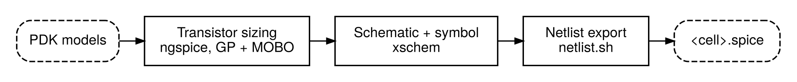

# 1. Schematic

Transistor sizing at all 15 PVT corners, schematics and symbols in xschem, and the netlists used by every later stage.



```
bash flow.sh sizing <cell>          # sizing run, results in sizing_work/<cell>/
bash flow.sh sizing seq <dlx4|dffx4>
bash flow.sh schematic [CELL ...]   # netlists from cells/<CELL>/schematic/<cell>.sch
```

## Examples

```
bash flow.sh sizing inv1x4                     # full sizing run for INV1X4 -> sizing_work/inv1x4/finalists_report.csv
bash flow.sh sizing and2x4_out                 # size only the output inverter of AND2X4
bash flow.sh sizing seq dffx4                  # DFFX4 storage loop, then input gate and clock inverter
bash scripts/schematic/sizing/verify_cell.sh nand2x4 3.36 5.04 0.26 0.22   # check given Wn Wp Ln Lp at 15 corners + Monte Carlo
bash scripts/schematic/sizing/status.sh        # progress of every sizing run
xschem cells/NAND2X4/schematic/nand2x4.sch     # open a schematic to edit it
bash flow.sh schematic                         # export all 13 netlists
bash flow.sh schematic NAND2X4 DFFX4           # export two netlists
```

## Key settings

- **Design variables:** W and L of the pull-down and pull-up networks; widths in fingers of 0.84 µm, lengths on a 0.01 µm grid.
- **Load:** four copies of the cell (FO4).
- **Targets:** noise margin ≥ 40 mV at the critical corners (tt 27, sf 0, fs 85, ss 85, ff 85 °C), rise/fall asymmetry ≤ 25 % at tt 27 °C, full 0–VDD swing.
- **Search:** Sobol sweep, Gaussian-process surrogates, multi-objective Bayesian optimization; the picked design is checked at all 15 corners and with Monte Carlo mismatch (mean − 3σ of the noise margin ≥ 0).
- **Compound cells** reuse sized stages: AND2/OR2 = NAND2/NOR2 + output inverter; XOR2, XNOR2, MAOI4, MOAI4 have INV1X4-sized input inverters.
- **Sequential cells:** clock inverter, input and feedback transmission gates and output inverters sized as roles; hold noise margin ≥ 40 mV at 15 corners.
- **Schematics:** ports named as in the Liberty files plus `VDD` / `GND`; device names (`M1`, `M2`, ...) are referenced by the layout recipes, so keep them when editing.
- **Netlists:** one `.subckt` per cell, each device with `L`, `W` and `nf` only; `netlist.sh` rewrites a file only when its content changes.

## Results

Output stage sizes (W / L in µm; AOI3X4 C NMOS and OAI3X4 C PMOS: 2.52 µm). Every device is in `cells/<CELL>/spice/<cell>.spice`.

| Cell | Transistors | NMOS | PMOS |
|---|---|---|---|
| INV1X4 | 2 | 0.84 / 0.29 | 1.68 / 0.21 |
| NAND2X4 | 4 | 3.36 / 0.26 | 5.04 / 0.22 |
| NOR2X4 | 4 | 2.52 / 0.26 | 4.20 / 0.20 |
| AND2X4 | 6 | 2.52 / 0.29 | 5.04 / 0.21 |
| OR2X4 | 6 | 2.52 / 0.29 | 5.04 / 0.21 |
| XOR2X4 | 12 | 4.20 / 0.29 | 4.20 / 0.19 |
| XNOR2X4 | 12 | 4.20 / 0.29 | 4.20 / 0.19 |
| AOI3X4 | 6 | 4.20 / 0.26 | 5.04 / 0.20 |
| OAI3X4 | 6 | 4.20 / 0.26 | 5.04 / 0.20 |
| MAOI4X4 | 12 | 3.36 / 0.28 | 4.20 / 0.20 |
| MOAI4X4 | 12 | 3.36 / 0.28 | 4.20 / 0.20 |
| DLX4 | 10 | 1.68 / 0.29 | 3.36 / 0.21 |
| DFFX4 | 18 | 1.68 / 0.29 | 3.36 / 0.21 |
