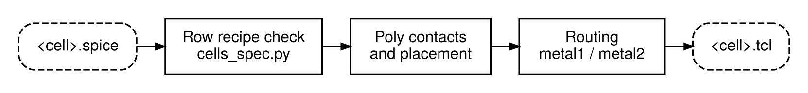

# 2. Layout generation

Each netlist is placed and routed on a fixed cell template and written as a Magic script.



```
bash flow.sh layout [CELL ...]      # writes cells/<CELL>/layout/<cell>.tcl
```

## Examples

```
bash flow.sh layout                            # all 13 cells
bash flow.sh layout NAND2X4                    # one cell -> cells/NAND2X4/layout/nand2x4.tcl
bash flow.sh layout XOR2X4 XNOR2X4             # two cells
```

## Key settings

- **Template:** height 4.08 µm, width a multiple of the 0.46 µm site; metal1 rails on both edges with substrate and n-well taps; n-well from y = 2.20 µm.
- **Rows:** NMOS diffusion at the bottom, PMOS at the top; series stacks folded into finger pairs, parallel devices as shared-diffusion fingers.
- **Gates:** fingers on the same net joined by poly bars, one poly contact per run, contacts kept out of neighbouring columns.
- **Routing:** 8 horizontal metal1 tracks, vertical metal2 on source/drain columns, A* search over the track grid.
- **Devices:** drawn flat (no device subcells), so LVS and extraction see plain transistors.
- **Editing a cell:** change its row recipe in `scripts/layout/cells_spec.py` and rerun the stage; the output is identical from run to run.

## Results

| Cell | Width (µm) | Sites | Area (µm²) |
|---|---|---|---|
| INV1X4 | 2.30 | 5 | 9.38 |
| NAND2X4 | 7.36 | 16 | 30.03 |
| NOR2X4 | 6.44 | 14 | 26.28 |
| AND2X4 | 10.58 | 23 | 43.17 |
| OR2X4 | 9.66 | 21 | 39.41 |
| XOR2X4 | 15.18 | 33 | 61.93 |
| XNOR2X4 | 15.18 | 33 | 61.93 |
| AOI3X4 | 10.58 | 23 | 43.17 |
| OAI3X4 | 9.20 | 20 | 37.54 |
| MAOI4X4 | 15.18 | 33 | 61.93 |
| MOAI4X4 | 14.72 | 32 | 60.06 |
| DLX4 | 12.42 | 27 | 50.67 |
| DFFX4 | 15.64 | 34 | 63.81 |
