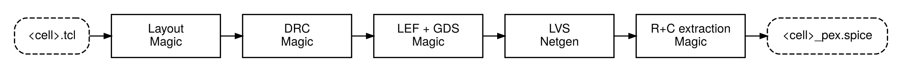

# 3. Layout verification

Each layout is built in Magic, checked for DRC and LVS against its netlist, and extracted with parasitics for characterization.



```
bash flow.sh verify [CELL ...]      # views in cells/<CELL>/layout/, reports in cells/<CELL>/verification/
```

## Examples

```
bash flow.sh verify                            # all 13 cells -> cells/verification_summary.txt
bash flow.sh verify INV1X4                     # one cell
bash flow.sh verify DLX4 DFFX4                 # the two sequential cells
bash scripts/verification/lvs.sh inv1x4        # rerun only Netgen LVS (after a verify run)
python3 scripts/verification/check_cells_switchlevel.py lib/tt_27c/subvt_sky130_tt_0p40v_27c.lib cells
```

## Key settings

- **DRC:** sky130A rules in Magic; report `verification/drc/<cell>_drc.rpt`, target 0 error boxes.
- **LEF / GDS:** `layout/<cell>.lef`, `.gds`; LEF `SIZE W BY 4.080` with W a multiple of 0.46.
- **LVS:** Netgen with the sky130A setup against `spice/<cell>.spice`; target `Circuits match uniquely`.
- **Extraction:** R and coupling C with no thresholds, `verification/pex/<cell>_pex.spice`; used by characterization.
- **Summary:** one line per cell in `cells/verification_summary.txt`.
- **Switch-level check:** every combinational netlist is checked against its Liberty function for all input vectors (`scripts/verification/check_cells_switchlevel.py`); result `ALL PASS` for the 11 combinational cells.

## Results

| Cell | DRC errors | LVS | Extracted R / C |
|---|---|---|---|
| INV1X4 | 0 | match | 20 / 23 |
| NAND2X4 | 0 | match | 130 / 125 |
| NOR2X4 | 0 | match | 103 / 96 |
| AND2X4 | 0 | match | 190 / 177 |
| OR2X4 | 0 | match | 162 / 147 |
| XOR2X4 | 0 | match | 301 / 270 |
| XNOR2X4 | 0 | match | 303 / 272 |
| AOI3X4 | 0 | match | 203 / 191 |
| OAI3X4 | 0 | match | 196 / 187 |
| MAOI4X4 | 0 | match | 270 / 253 |
| MOAI4X4 | 0 | match | 271 / 255 |
| DLX4 | 0 | match | 167 / 163 |
| DFFX4 | 0 | match | 213 / 203 |
