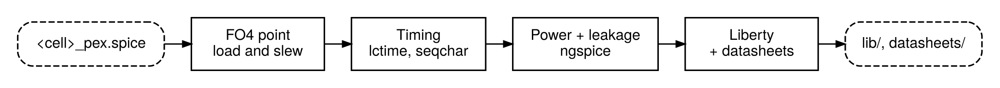

# 4. Characterization

Timing, power and leakage of every cell on its extracted netlist at 15 corners, assembled into Liberty files and HTML datasheets.



```
bash flow.sh char [corners|all] [cells|all]   # lib/<proc>_<T>c/, datasheets/index.html
```

## Examples

```
bash flow.sh char                              # all 15 corners, all 13 cells, then datasheets
bash flow.sh char tt_27c                       # one corner, all cells
bash flow.sh char tt_27c,ss_0c inv1x4,dffx4    # two corners, two cells
JOBS=4 bash flow.sh char ff_85c                # limit the parallel simulations
```
A corner whose library already exists in `lib/` is skipped; remove `lib/<proc>_<T>c/` to characterize it again.

## Key settings

- **Corners:** tt, ss, ff, sf, fs at 0, 27 and 85 °C, all at 0.40 V; sky130A FET models.
- **FO4 point:** load = 4 × mean input capacitance; slew = the output slew the cell itself produces at that load.
- **Grid:** 5 × 5 loads and slews at 0.25×, 0.5×, 1×, 2× and 4× the FO4 point.
- **Thresholds:** delay at 50 %, slew from 30 % to 70 %.
- **Tools:** lctime for combinational cells; ngspice scripts for DLX4 / DFFX4 timing, setup and hold (10 % CLK→Q push-out), internal power and leakage per input state.
- **Outputs:** `lib/<proc>_<T>c/subvt_sky130_<proc>_0p40v_<T>c.lib`, per-cell libraries and grids in `cells/<CELL>/characterization/`, `datasheets/index.html`.

## Results

tt 27 °C at each cell's FO4 point (delays: mean over all arcs):

| Cell | FO4 load (fF) | Delay rise / fall (ns) | Leakage (pW) |
|---|---|---|---|
| INV1X4 | 12.5 | 3271 / 3022 | 0.26 |
| NAND2X4 | 47.3 | 6584 / 7202 | 1.19 |
| NOR2X4 | 38.6 | 5226 / 4408 | 1.21 |
| AND2X4 | 46.3 | 6335 / 5710 | 2.12 |
| OR2X4 | 37.5 | 4775 / 5059 | 1.87 |
| XOR2X4 | 65.2 | 8409 / 8448 | 3.56 |
| XNOR2X4 | 67.5 | 8697 / 8750 | 3.56 |
| AOI3X4 | 45.1 | 5690 / 5724 | 1.57 |
| OAI3X4 | 46.5 | 6298 / 6266 | 2.33 |
| MAOI4X4 | 28.0 | 6375 / 6384 | 2.77 |
| MOAI4X4 | 28.2 | 6514 / 6287 | 2.83 |
| DLX4 | 31.2 | 8263 / 8426 | 2.58 |
| DFFX4 | 34.5 | 12103 / 12273 | 3.61 |

Across corners (FO4 point; leakage is the mean of the 13 cells):

| Corner | INV1X4 delay rise / fall (ns) | DFFX4 CLK→Q rise / fall (ns) | Leakage (pW) |
|---|---|---|---|
| tt 27 °C | 3271 / 3022 | 13573 / 15883 | 2.27 |
| ss 0 °C | 38710 / 23572 | 135300 / 154483 | 1.94 |
| sf 0 °C | 131547 / 31718 | 307926 / 270868 | 1.97 |
| ff 85 °C | 168 / 283 | 1123 / 1179 | 76.76 |
| fs 85 °C | 262 / 1333 | 3621 / 3954 | 162.69 |
