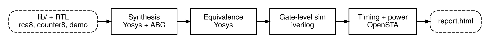

# 5. Synthesis

Three small designs mapped onto this library (X4) and onto the matching sky130_fd_sc_hd cells, checked against their RTL, then timed and power-analysed.



```
bash flow.sh synth [designs]        # synthesis, equivalence, gate-level simulation -> synthesis/out/
bash flow.sh bench [designs]        # timing, power, report -> synthesis/out/report/report.html
```

## Examples

```
bash flow.sh synth                             # rca8, counter8, demo on X4 and hd
bash flow.sh bench                             # their timing, power and report
bash flow.sh synth rca8 && bash flow.sh bench rca8               # one design
bash flow.sh synth rca8,counter8 && bash flow.sh bench rca8,counter8
```

## Key settings

- **Designs:** `rca8` (8-bit ripple-carry adder), `counter8` (8-bit counter with reset and enable), `demo` (uses all 13 cells); RTL in `synthesis/rtl/`, self-checking testbenches in `synthesis/tb/`.
- **Reference:** sky130_fd_sc_hd at tt 25 °C, 1.80 V, cut down to the 13 matching cells (`inv_1`, `nand2_1`, `nor2_1`, `and2_1`, `or2_1`, `xor2_1`, `xnor2_1`, `a21oi_1`, `o21ai_1`, `a2bb2oi_1`, `a2bb2o_1`, `dlxbp_1`, `dfxbp_1`).
- **Synthesis:** Yosys with ABC on the tt 27 °C library; flip-flops and latches mapped onto DFFX4 / DLX4.
- **Checks:** Yosys equivalence of netlist and RTL, then gate-level simulation against the RTL, which also records the switching activity.
- **Timing and power:** OpenSTA with inputs driven by the library inverter and outputs loaded with four inverter inputs; power at Fmax with the simulated activity; energy per operation = power × critical delay.

## Results

| Design | Library | Cells | Area (µm²) | Critical delay | Fmax | Energy per operation | Checks |
|---|---|---|---|---|---|---|---|
| rca8 | X4, 0.40 V | 70 | 2120.8 | 45.7 µs | 21.9 kHz | 24.3 fJ | PASS |
| rca8 | hd, 1.80 V | 53 | 260.2 | 1.28 ns | 779 MHz | 78.3 fJ | PASS |
| counter8 | X4, 0.40 V | 47 | 1655.3 | 48.8 µs | 20.5 kHz | 50.0 fJ | PASS |
| counter8 | hd, 1.80 V | 49 | 362.8 | 1.09 ns | 920 MHz | 480.3 fJ | PASS |
| demo | X4, 0.40 V | 109 | 4053.9 | 45.8 µs | 21.8 kHz | 116.0 fJ | PASS |
| demo | hd, 1.80 V | 102 | 783.3 | 0.83 ns | 1.21 GHz | 901.7 fJ | PASS |

Energy per operation is 3.2× (rca8), 9.6× (counter8) and 7.8× (demo) lower with X4. The report also lists every corner of the X4 library.
