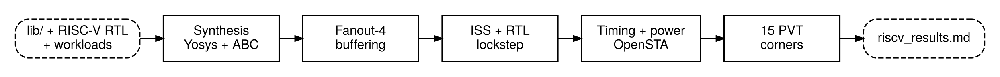

# 6. Benchmarking

Four open-source RV32I cores built on this library (X4) and on sky130_fd_sc_hd, verified on five workloads, then compared on speed and energy at the typical corner and across all 15 X4 corners.



```
bash flow.sh riscv-synth [cores]    # synthesis, buffering, checks -> benchmarking/out/
bash flow.sh riscv-bench [cores]    # Fmax, power, energy, 15 corners -> benchmarking/out/riscv_results.md
```

## Examples

```
bash flow.sh riscv-synth                       # all four cores, five workloads, X4 and hd
bash flow.sh riscv-bench                       # their Fmax, power, energy and 15 corners
bash flow.sh riscv-synth dark && bash flow.sh riscv-bench dark   # DarkRISCV only
bash flow.sh riscv-synth serv,pico && bash flow.sh riscv-bench serv,pico
python3 scripts/synthesis/rv_iss.py benchmarking/prog/kmp.hex    # expected result and instruction count of one workload
```

## Key settings

- **Cores:** SERV (bit-serial), FemtoRV32 Quark, PicoRV32, DarkRISCV (3-stage pipeline); sources and versions in `benchmarking/README.md`.
- **Workloads:** `sortcrc`, `gemm`, `stencil`, `kmp`, `spmv` (4879 to 9949 instructions each).
- **Synthesis:** Yosys with ABC, register files built from library flip-flops; every net buffered to a fanout of at most 4 with inverter pairs.
- **Checks:** an instruction-set simulator gives the expected result and stores; RTL and gate-level simulations must match it and each other cycle for cycle.
- **Timing and power:** OpenSTA at FO4 output load; power at Fmax with each workload's switching activity.
- **Energy:** per cycle = power ÷ Fmax; per instruction = energy per cycle × CPI; suite values are totals over the five workloads.
- **Corners:** the tt netlists and activity re-timed with all 15 X4 libraries.

## Results

Typical corner (X4 tt 27 °C, hd tt 25 °C), all five workloads:

| Core | Cells X4 / hd | Fmax X4 / hd | CPI | Energy per instruction X4 / hd | X4 vs hd | Checks |
|---|---|---|---|---|---|---|
| SERV | 7777 / 8408 | 8.83 kHz / 394 MHz | 57.95 | 297 pJ / 3.35 nJ | 11.3× lower | PASS |
| FemtoRV32 Quark | 13582 / 13589 | 5.39 kHz / 234 MHz | 8.82 | 62.8 pJ / 477 pJ | 7.6× lower | PASS |
| PicoRV32 | 16579 / 16456 | 8.31 kHz / 302 MHz | 6.38 | 48.6 pJ / 437 pJ | 9.0× lower | PASS |
| DarkRISCV | 15750 / 14993 | 4.49 kHz / 204 MHz | 1.26 | 16.6 pJ / 100 pJ | 6.0× lower | PASS |

X4 across the 15 corners:

| Core | Fmax SF 0 °C / FF 85 °C | Energy per instruction FF 27 °C / SF 0 °C | Min hold slack |
|---|---|---|---|
| SERV | 386 Hz / 133 kHz | 260 pJ / 1.90 nJ | 400 ns |
| FemtoRV32 Quark | 221 Hz / 78.3 kHz | 49.5 pJ / 710 pJ | 380 ns |
| PicoRV32 | 329 Hz / 120 kHz | 41.0 pJ / 418 pJ | 524 ns |
| DarkRISCV | 192 Hz / 67.4 kHz | 14.1 pJ / 133 pJ | 72 ns |

Per-workload and CPI tables: `benchmarking/results/riscv_results.md`.
