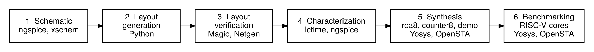

# Documentation

| # | Stage | Command | Main output |
|---|---|---|---|
| 1 | [Schematic](01_schematic.md) | `bash flow.sh schematic` | `cells/<CELL>/spice/<cell>.spice` |
| 2 | [Layout generation](02_layout.md) | `bash flow.sh layout` | `cells/<CELL>/layout/<cell>.tcl` |
| 3 | [Layout verification](03_verification.md) | `bash flow.sh verify` | `.mag`, `.lef`, `.gds`, `_pex.spice` |
| 4 | [Characterization](04_characterization.md) | `bash flow.sh char` | `lib/`, `datasheets/` |
| 5 | [Synthesis](05_synthesis.md) | `bash flow.sh synth`, `bash flow.sh bench` | `synthesis/out/report/report.html` |
| 6 | [Benchmarking](06_benchmark.md) | `bash flow.sh riscv-synth`, `bash flow.sh riscv-bench` | `benchmarking/out/riscv_results.md` |

Container setup: [docker.md](docker.md). Tool versions: [PDK_VERSION.md](../pdk/PDK_VERSION.md). RISC-V sources: [benchmarking/README.md](../benchmarking/README.md).
